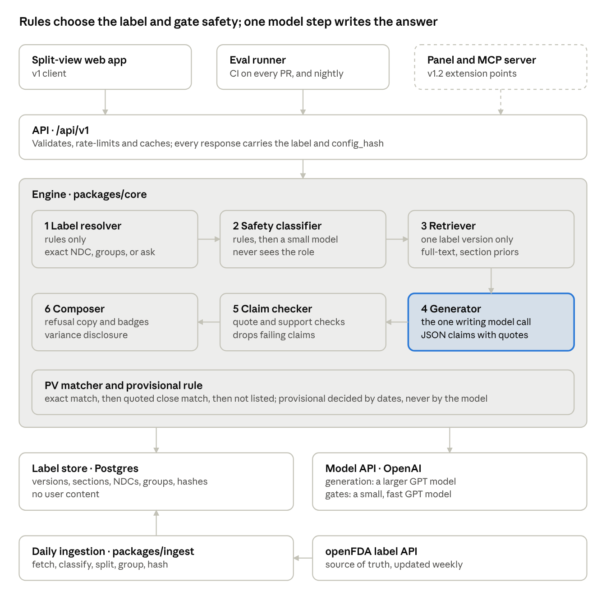
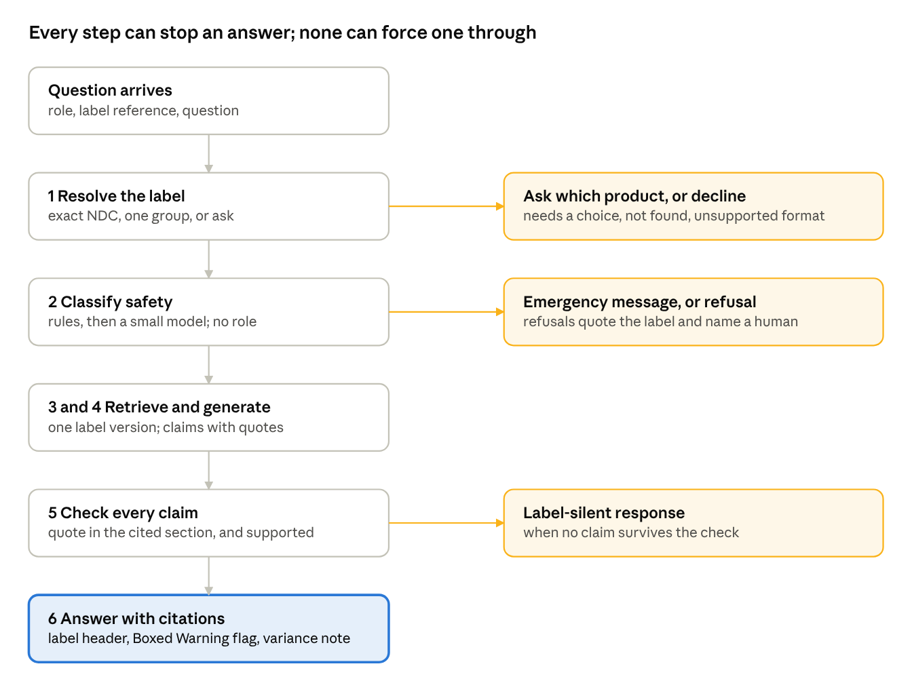
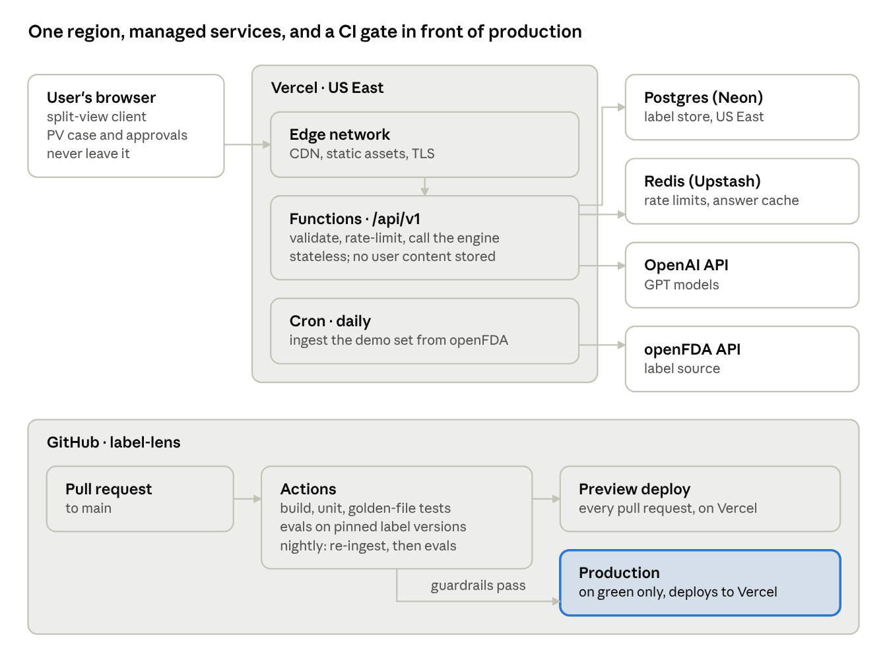

# Label Lens — Solution Architecture (HLD, LLD, Deployment)

Nov 5, 2026 · Tamil Selvan

Label Lens is a **headless, API-first engine** with a split-view web app as its first client. Label choice, safety classification and claim checking are **deterministic gates around one narrow LLM step**, so the model never picks a label or makes a final safety call. Everything ships on a small serverless stack (Vercel, Postgres, the OpenAI API), and an **eval gate in CI** blocks any release that breaks a guardrail.

> Scope: v1 only (Pharmacist, Medical Information, PV), under the scope freeze (D-18). The v1.2 surfaces (embeddable panel, MCP server, label history) appear only as extension points. Requirement and decision IDs refer to the [PRD](PRD.md).

## 1. What we did so far

We worked from positioning to product to evidence, and every stage produced a decision that the architecture now has to honour.

| Stage | What we did | Output | Decisions it produced |
| --- | --- | --- | --- |
| 1. Positioning | Audited the empty GitHub profile, read the LinkedIn background, found the "three eras of validation" story (by hand, as software with QSpace, as AI) | Profile README live; headline "Product leader at the intersection of LSHC, compliance and AI" | Thesis: in LSHC, evals are the new validation |
| 2. Product choice | Chose Label Lens: cited answers from FDA drug labels, refusing well | Discovery draft v0.1 | Role-based for 5 roles; a role is a lens, not a permission (D-01) |
| 3. PRD structure | Adopted a validated-system PRD structure: requirement, edge case, test case | PRD v0.2 | Traceability is the evidence (D-05) |
| 4. Data check | Ran 11 live queries against openFDA | Data check doc | PLR Rx labels only in v1; label history from DailyMed (D-06, D-08) |
| 5. Journeys | Role first, split view, PV starts from a case, human approval on close matches | PRD journeys J-01 to J-04 | D-09 to D-11 |
| 6. Plugin direction | Designed for embedding in LSHC enterprise apps | F-07, F-08, section 6.5 | API-first core; no vendor plugins (D-12 to D-14) |
| 7. Repo | Created `label-lens` with README, PRD and data check | github.com/TamilKaleinz/label-lens | Build in public |
| 8. Demo set and evals | Picked 19 edge-case labels, verified every ID, wrote 48 eval cases | `demo-drug-set.md`, `cases-v0.1.csv` | Context-aware label resolution, equivalence groups, provisional PV verdicts, scope freeze (D-15 to D-18) |

## 2. How we arrived at the architecture

The architecture wasn't picked from a template. Each component exists because a requirement, a decision or a data finding made it necessary. Reading the table left to right is the argument for the design.

| Driver | Where it came from | Architectural consequence |
| --- | --- | --- |
| Answers only from the label; every claim cited | FR-F03-01, FR-F03-02, GM-01 | Label-scoped retrieval, a generation step that must return quote spans, and a **claim checker** that drops any claim whose quote isn't in the retrieved text |
| The model must never pick the label | D-15, D-16, GM-07 | A **deterministic label resolver**; equivalence groups computed at ingestion, not at question time |
| Labels are messy: duplicates, three formats, Highlights text merged into sections | Data check, demo set | An **ingestion pipeline** with a format classifier, section and subsection splitter, and golden-file tests for each demo label |
| Repackager labels lag originals | Demo set (DS-02, DS-07) | **Section hashes** stored per label, so text differences within a group can be disclosed (FR-F01-09) |
| A role is a lens, not a permission | D-01, D-04, GM-04 | The **safety classifier never receives the role**; the role is applied only in the style layer, after safety is decided |
| PV verdicts can be provisional and need human approval | D-11, D-17, GM-06, GM-08 | Recent Major Changes parsed into **structured dates** at ingestion; a deterministic provisional rule; verdicts as a small **state machine** |
| No personal data; no logins in v1 | PRD 6.4, won't-do list | A **stateless API for user content**: questions aren't stored, and the PV case lives in the browser and the export, never on the server |
| Embeddable later (panel, MCP) | D-12, F-07 | The engine is a **pure library behind a versioned HTTP API**; every surface, the web app included, is a client |
| Model, prompt or retrieval changes must re-run the evals | AI-01, AI-03 | A **versioned config bundle** (model, prompts, retrieval settings, one hash) and an **eval gate in CI** |
| Labels change weekly; evals must be reproducible | Data check, demo set | An **immutable label store** keyed by set ID and version; evals pin versions |
| One builder, 10 to 20 hours a week, scope freeze | D-18 | **Managed serverless**, one repo, one language (TypeScript); no servers or clusters to run |
| A public demo calls a paid model | Rollout plan | **Rate limiting, response caching and a spend cap** at the edge |

Five principles fall out of that table, and they decide anything the table doesn't cover:

1. **Deterministic where possible, probabilistic only where needed.** Rules pick the label, detect emergencies and check quotes. The model reads and writes.
2. **Evidence travels with the answer.** Every response carries its label ID, version, sections, quotes and config hash.
3. **Fail closed.** When grouping, retrieval or a claim is uncertain, ask or decline; never guess.
4. **Stateless for user data.** The server stores labels and anonymous counts, nothing a user typed.
5. **Everything versioned, everything evaluated.** No change reaches production without an eval run against pinned labels.

## 3. High-level design



A question passes six steps in order. Only step 4 writes text with a model. Steps 1 and 6 are pure rules, and steps 2 and 5 are rules backed by a small model, so a label is never chosen, and a refusal never overturned, by the generating model. Every client, including the eval runner, uses the same API.

| Component | Responsibility | Decides with | Requirements it carries |
| --- | --- | --- | --- |
| Label resolver | Exact product, equivalence groups, ask or decline | Rules | F-01, D-15, D-16, GM-07 |
| Safety classifier | Emergency, personal advice, out of scope, low confidence | Rules, then a small model | F-04, D-04, GM-02 |
| Retriever | Find the cited text inside one label version | Search | FR-F03-01 |
| Generator | Write claims with quotes, in the role's style | Model | F-02, F-03 |
| Claim checker | Drop any claim not supported by its quote | Rules, then a small model | GM-01 |
| Composer | Refusal copy, badges, Boxed Warning flag, variance note | Rules | F-04, FR-F01-09 |
| PV matcher | Listedness proposals and provisional flags | Rules; model only proposes close matches | F-05, D-11, D-17 |
| Ingestion | Build the label store from openFDA | Rules, golden-file tests | D-06, data check |

### 3.1 Answer flow



The amber exits are where Label Lens fails closed (principle 3). An answer reaches step 6 only when exactly one label is resolved, the question is safe to answer, and at least one claim survives the quote and support checks. The PV listedness flow follows the same pattern, with the human approval step (4.4.8) as its final gate.

## 4. Low-level design

### 4.1 Repository and modules

One TypeScript monorepo. The engine is a library with no web framework inside it, so the API, the evals and (later) the MCP server all call the same code.

| Path | Contains | Depends on |
| --- | --- | --- |
| `packages/core` | Label resolver, safety classifier, retriever, generator, claim checker, response composer, PV matcher, provisional rule | `packages/db`, model client |
| `packages/ingest` | openFDA fetch, format classifier, section and subsection splitter, equivalence grouping, section hashing | `packages/db` |
| `packages/db` | Schema, migrations, typed queries | Postgres |
| `apps/web` | Next.js split-view client and the `/api/v1` route handlers (thin: validate, rate-limit, call `core`) | `packages/core` |
| `config/` | Model IDs, prompts, retrieval settings, refusal copy; hashed into one `config_hash` | none |
| `evals/` | `demo-drugs.csv`, `cases-v0.1.csv`, runner, graders, reports | the HTTP API |

### 4.2 Data model

Postgres holds labels and derived structure only. There are **no tables for questions, answers, PV cases or users** (principle 4).

| Table | Key columns | Purpose |
| --- | --- | --- |
| `label_version` | `set_id`, `version` (PK), `spl_id`, `effective_date`, `manufacturer`, `is_original_packager`, `product_type`, `routes[]`, `substances[]`, `dosage_form`, `release_type`, `form_confidence`, `format` (PLR, NON\_PLR, OTC), `raw` (jsonb), `retrieved_at` | Immutable snapshot of every label version ingested |
| `label_current` | `set_id` → `version` | Pointer to the latest version; evals pin versions instead |
| `ndc` | `product_ndc`, `package_ndc`, `set_id`, `version` | Exact-product lookup (FR-F01-02) |
| `section` | `set_id`, `version`, `code` (BW, 1, 2.2, 5.3…), `title`, `kind` (boxed, section, subsection), `text`, `text_hash` | Citable units; hashes power variance disclosure |
| `chunk` | `id`, `set_id`, `version`, `section_code`, `text`, `tsv`, `embedding` (optional) | Retrieval units, never crossing a subsection boundary |
| `recent_major_change` | `set_id`, `version`, `section_ref`, `change_month` | Structured dates for the provisional rule (D-17) |
| `equiv_group` / `group_member` | `group_id`, `substances_key`, `dosage_form`, `release_type`, `route`, `uncertain` / `set_id`, `version`, `is_representative` | Precomputed groups (D-16) |
| `section_variance` | `group_id`, `section_code`, `distinct_hashes` | "Other labels word this differently" (FR-F01-09) |
| `term_synonym` | `term`, `canonical`, `source` | Curated PV synonyms. MedDRA isn't used, because its licence doesn't allow public redistribution |

### 4.3 API contracts (v1)

All responses carry `label` (set ID, version, SPL ID, manufacturer, effective date, NDC if known) and `config_hash`.

| Endpoint | Request | Response |
| --- | --- | --- |
| `GET /api/v1/labels/resolve` | `ndc` or `set_id` or `q`, plus `role` | `status`: resolved, needs\_choice, not\_found or unsupported\_format; `label`; `groups[]` when a choice is needed; `representative` (true or false) |
| `GET /api/v1/labels/{set_id}` | optional `version` | Label header and sections, for the right-hand label pane |
| `POST /api/v1/answer` | `role`, `set_id`, `version`, `question` | `kind`: answer, refusal, clarify or emergency; `refusal_type`; `claims[]` of {`text`, `section_code`, `quote`, `offsets`}; `disclosures[]`; `boxed_warning_flag` |
| `POST /api/v1/pv/listedness` | `set_id`, `version`, `events[]`, optional `receipt_date` | Per event: `proposal` (listed, possible\_match, not\_listed), `provisional` and its reason, `evidence[]` of {`section_code`, `quote`}, `rationale` |

Approvals and the export stay in the browser (4.4.9). Errors: `400` invalid input, `429` rate limited, `503` label source or model unavailable, each with the user-facing message from the PRD edge-case tables.

### 4.4 Module internals

**4.4.1 Ingestion** (`packages/ingest`, scheduled daily)

1. Fetch each label in the demo set from openFDA by set ID; store a new `label_version` only when the version number changes.
2. Classify the format: `OTC` when the product type is OTC; `PLR` when a Warnings and Precautions field exists; otherwise `NON_PLR`. Only PLR labels are answerable in v1 (D-06).
3. Map openFDA fields to section codes (boxed warning → BW, indications → 1, dosage → 2, contraindications → 4, warnings and precautions → 5, adverse reactions → 6, interactions → 7, specific populations → 8 and its subsections).
4. Strip the Highlights summary that some fields begin with (text before the first `N.1` heading that cites `( N.x )`), then split subsections on headings like `5.3 Hepatic Injury`.
5. Read dosage form and release type from the description and product data ("extended-release", "oral solution", "injection"). Conflicting or missing signals set `form_confidence = low`, which marks the group `uncertain` (FR-F01-08).
6. Parse Recent Major Changes into `(section_ref, change_month)` rows.
7. Hash every section, rebuild equivalence groups, pick each group's representative (newest original packager), and update `section_variance`.
8. Golden-file tests: for every demo label, the expected section list and key sentences are checked after each ingest. A failure stops the pointer update.

**4.4.2 Label resolver** (`core/resolve`, deterministic)

```text
resolve(ref, role):
  if ref.ndc or ref.set_id:
    label = lookup_exact(ref)            # repackager labels included (FR-F01-02)
    if none: return not_found            # never substitute (FR-F01-03)
  else:
    groups = groups_matching(ref.q)      # fuzzy name match over brand and generic names
    if groups is empty: return not_found
    if len(groups) > 1 or groups[0].uncertain: return needs_choice(groups)
    if role != pharmacist: return needs_choice(groups[0].members)   # FR-F01-07
    label = groups[0].representative     # badge + switch (FR-F01-06)
  if label.format != PLR: return unsupported_format(label)          # EC-F01-06
  return resolved(label)
```

**4.4.3 Safety classifier** (`core/safety`; input is the question only, never the role)

1. **Rules first:** an emergency lexicon (overdose, can't breathe, took too many…) short-circuits to the emergency response (EC-F04-05). Personal-dosing patterns ("my patient", "should I", a dose plus a person) mark personal advice.
2. **Small model second:** a fast, small model returns `{class, confidence}` over: answerable, personal\_advice, out\_of\_scope, other. Below the threshold (Q-04), the result is low\_confidence.
3. The class is fixed before retrieval; nothing later can upgrade a refusal into an answer.

**4.4.4 Retriever** (`core/retrieve`, label-scoped)

Searches only the chunks of the resolved label version: full-text ranking plus optional embeddings, with section priors (dose questions favour 2 and 8.6; safety questions favour BW and 5). It returns the top chunks plus the Boxed Warning, so FR-F03-04 can flag it.

**4.4.5 Generator** (`core/generate`)

One model call at temperature 0, with the rules, the role's style block and the retrieved chunks. Output must match a JSON schema: `claims[]` of {`text`, `section_code`, `quote`}, or `label_silent: true`. The role changes wording and depth only (D-01).

**4.4.6 Claim checker** (`core/verify`, the GM-01 gate)

1. **Quote check (deterministic):** each claim's quote must appear verbatim, after whitespace normalisation, in a retrieved chunk of the section it cites. A wrong section counts as a failure.
2. **Support check (small model):** the claim text must be supported by its quote. Unsupported claims are dropped, not rewritten.
3. If no claims survive, the response becomes the label-silent or low-confidence pattern. Every drop is counted in metrics; eval case UC-04 seeds one on purpose.

**4.4.7 Response composer** (`core/compose`)

Applies the refusal copy from the PRD edge-case tables, the representative-label badge, the Boxed Warning flag, and "other labels in this group word this differently" when `section_variance` shows more than one hash for a cited section (FR-F01-09).

**4.4.8 PV matcher and provisional rule** (`core/pv`)

1. Normalise the event term (case, plurals, curated synonyms).
2. **Exact:** the term or a curated synonym appears in BW, 5 or 6 → propose **Listed**, with every location quoted.
3. **Close:** otherwise a model proposes up to three label phrases that may correspond ("hepatic injury" for "hepatotoxicity"). Each must pass the quote check → propose **Possible match**.
4. **None:** propose **Not listed**.
5. **Provisional** (deterministic, D-17) when: there is no receipt date, or the label's effective date is after the receipt date, or any Recent Major Change month ends after the receipt date.

```text
proposed --approve(reason)--> approved     (Possible match)
proposed --reject(reason)---> rejected     (Possible match)
proposed --confirm----------> confirmed    (Listed, Not listed)
export allowed only when every event is approved, rejected or confirmed (EC-F05-02)
provisional flag never cleared in v1; it is printed on the record and the export
```

**4.4.9 Audit export** (in the browser)

The case, label identifiers (set ID, version, SPL ID), each proposal, its evidence, the decision, the reason, an approver name (typed, unverified in v1), timestamps and `config_hash` go into one JSON record. Each entry carries the hash of the previous entry, and the file carries a SHA-256 of the whole, so any edit is detectable. It also renders as a printable page. It is labelled as a demo audit trail, not a 21 CFR Part 11 system (PRD 6.5).

**4.4.10 Config bundle and versioning** (AI-01)

`config/` holds model IDs, prompts, retrieval settings and refusal copy. The build computes one `config_hash`; every response returns it, and every eval report records it. Changing any file changes the hash, which triggers the eval gate.

**4.4.11 Eval runner** (`evals/`)

1. Load `cases-v0.1.csv` and the pinned label versions from `demo-drugs.csv`; refuse to run if a pinned version is missing from the store.
2. Call the HTTP API as a client would.
3. **Deterministic graders:** expected label or status, cited section codes, must-not patterns, provisional flags, approval gate.
4. **Model-graded rubric** only for qualities rules can't judge (is the refusal helpful, does it name the right human), with the rubric versioned in `config/`.
5. Write a JSON and Markdown report (pass rate per category, every guardrail, `config_hash`) for `evals-as-prds`. Any failed guardrail-linked case fails the run.

## 5. Deployment architecture



Everything runs on managed services in one US East region (AD-09). The browser holds the only user state. Production changes only through GitHub, and only when the eval gate is green.

### 5.1 Environments

| Environment | Created by | Data | Model access | Purpose |
| --- | --- | --- | --- | --- |
| Local | Developer | A local Postgres seeded from pinned label snapshots | Developer key, low spend limit | Build and unit tests |
| Preview | Every pull request | A separate database branch from the pinned snapshots | Preview key, low spend limit | Review the change and run the eval gate |
| Production | Merge to main, after green checks | Production database; daily ingestion | Production key, monthly spend cap (AQ-03) | Public demo |

### 5.2 CI/CD and the eval gate

1. A pull request triggers GitHub Actions: type check, unit tests, and golden-file tests for every demo label.
2. Vercel builds a preview deploy for the pull request.
3. The eval runner runs `cases-v0.1.csv` against the preview, on pinned label versions, and posts the report on the pull request.
4. **Merge is blocked** if any guardrail-linked case fails (GM-01 to GM-08) or if the `config_hash` changed and no eval run exists for it.
5. Merge to main deploys production. Every deploy is immutable, so rollback is one click to the previous deploy.
6. **Nightly:** ingestion runs, and if any demo label has a new version, the full eval suite re-runs and opens an issue on any failure. This catches label drift, like the mid-2026 metformin Boxed Warning update.

### 5.3 Secrets and access

- Model, database, Redis and openFDA keys live only in the hosting platform's encrypted environment variables, scoped per environment; never in the repo.
- The ingestion endpoint is private: callable only by the scheduler, with a shared secret.
- Separate model keys per environment, each with its own spend limit.

### 5.4 Observability

- **Request logs** carry `config_hash`, label set ID and version, response kind, refusal type, claims dropped and latency, but never the question text.
- **Anonymous product counts** (PRD 7.3): answers served, evidence-panel opens (SM-01), refusals by type, role selected.
- **Alerts:** model or openFDA errors above a threshold, spend approaching the cap, nightly eval failure.

### 5.5 Abuse and cost controls

- Per-IP rate limits and a daily answer quota at the API, backed by Redis.
- An answer cache keyed by label version, role, normalised question and `config_hash`, so repeated demo questions don't call the model again.
- A small model for every gate and one generation call per answer.
- A hard spend cap per environment; when reached, the API returns a clear "demo paused" message.

### 5.6 Backup and recovery

The label store can always be rebuilt: ingestion is replayable from openFDA, and pinned snapshots are kept in the repo's eval fixtures. The managed database's point-in-time recovery covers the rest. No user data exists, so no user data can be lost.

### 5.7 From demo to production (pointer)

The gaps for a real GxP deployment (validation, Part 11 audit trails and e-signatures, SSO, a version-locked label source, data residency) are listed in PRD section 6.5. This architecture keeps them reachable: the API-first engine, versioned config, immutable label store and eval evidence are the parts a validated system would need anyway.

## 6. Architecture decisions and open questions

| ID | Decision | Why | Alternative considered |
| --- | --- | --- | --- |
| AD-01 | One TypeScript monorepo; the engine is a framework-free library | One builder; the API, evals and future MCP server share one code path | Python engine with a separate JS front end |
| AD-02 | Next.js on Vercel for the client and the `/api/v1` handlers | Preview deploy per pull request, zero ops; fits the taste reference | A container on a cloud VM |
| AD-03 | Managed serverless Postgres; full-text search first, vector search only if evals need it | Labels are small and scoped; Postgres keeps one store for labels, sections and groups | A dedicated vector database |
| AD-04 | The OpenAI API behind a provider interface: a larger GPT model for generation, a small, fast GPT model for classification and support checks | Strong instruction-following on structured output; a small model keeps the gates fast and cheap; the interface allows a swap | One model for every step |
| AD-05 | openFDA JSON in v1; DailyMed label history (SPL) added in v1.2 | openFDA is verified and enough for v1; history needs DailyMed (D-08) | Parsing SPL XML from day one |
| AD-06 | No user content on the server; PV case and approvals live in the browser and the export | Honours "no personal data"; nothing sensitive to secure or breach | Server-side case storage with logins |
| AD-07 | Curated PV synonym list, not MedDRA | MedDRA's licence doesn't allow public redistribution | MedDRA via a subscription |
| AD-08 | The eval gate runs in GitHub Actions on every pull request and nightly | Releases blocked on guardrails; nightly catches label drift | Manual eval runs |
| AD-09 | All services in one US East region | openFDA and most label users are US-based; one region keeps it simple. Latency from India is accepted for a demo | Multi-region |

**Open questions**

| Q ID | Question | How we'll settle it |
| --- | --- | --- |
| AQ-01 | Are embeddings needed, or does label-scoped full-text search pass the citation evals? | First M2 eval run |
| AQ-02 | Which confidence threshold routes to low confidence? (PRD Q-04) | First full eval run (M4) |
| AQ-03 | Monthly spend cap for the public demo | Set before launch from M4 cost per answer |
| AQ-04 | Is DailyMed reachable and stable enough for v1.2 label history? | Spike after M5, under the scope freeze |
